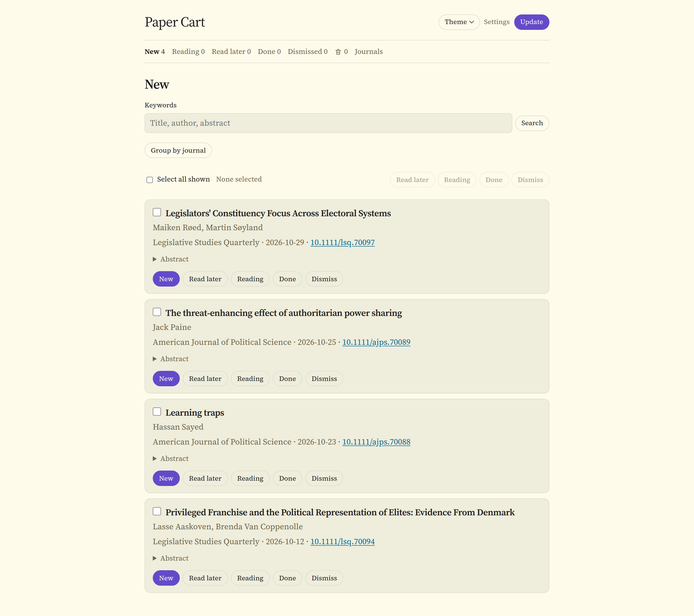
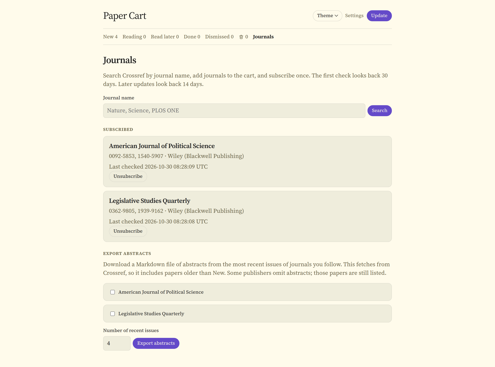
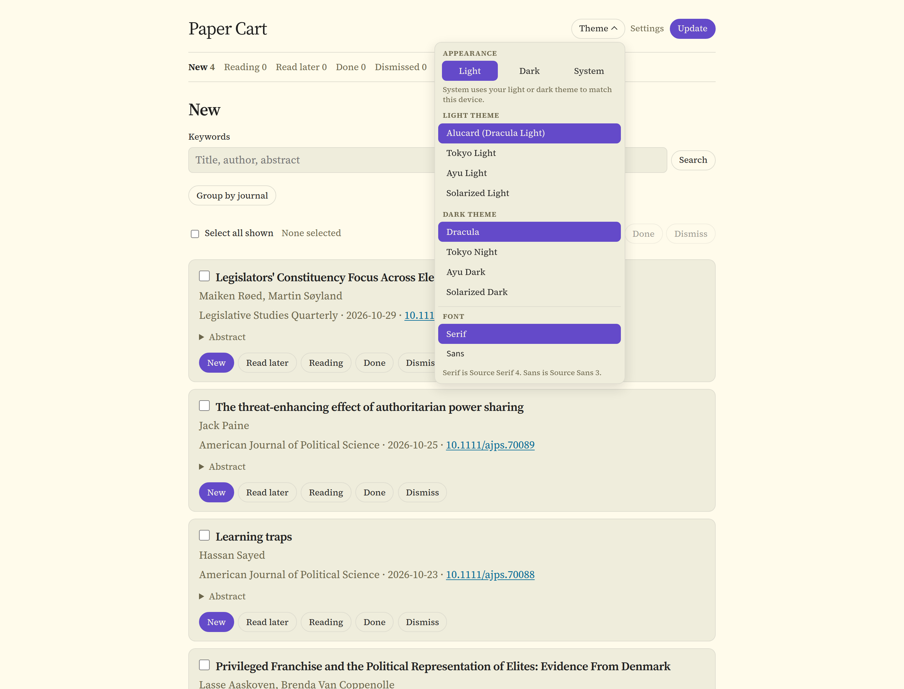
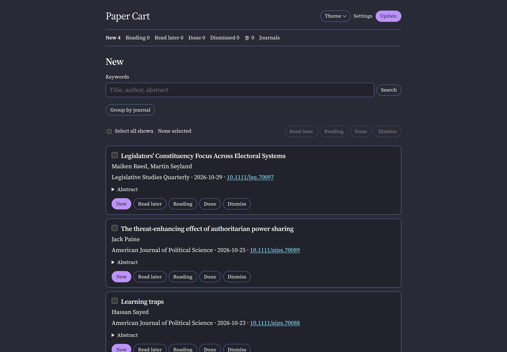
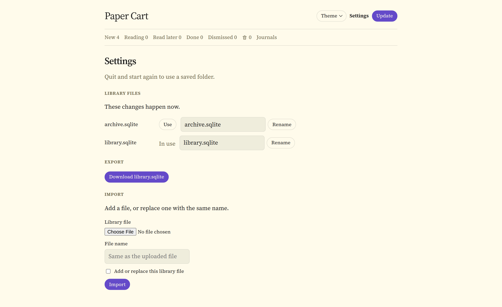

# Paper Cart

**Paper Cart follows the academic journals you choose and keeps a private reading list of their new articles on your own computer.**



<p align="center">
  <a href="#what-it-does">What it does</a> ·
  <a href="#install-on-a-mac">Install</a> ·
  <a href="#using-paper-cart">Use</a> ·
  <a href="#update-paper-cart">Update</a> ·
  <a href="#uninstall">Uninstall</a> ·
  <a href="#where-your-library-lives">Your library</a> ·
  <a href="#for-developers">For developers</a>
</p>

## What it does

- **Follows the journals you pick.** Search for a journal by name and subscribe. New articles arrive from [Crossref](https://www.crossref.org), the open registry of scholarly articles.
- **Keeps a reading list.** Mark each article as Read later, Reading, Done, or Dismiss it.
- **Stays private.** Your reading list is saved in a file on your computer. There is no account, no sign-up, and no cloud service.
- **Helps you find things.** Search your lists by keyword, group articles by journal, and file many articles at once.
- **Exports abstracts.** Download the titles, authors, DOIs, and abstracts from recent issues as one Markdown file.
- **Looks the way you like.** Light, dark, or match your Mac, with eight color themes and a serif or sans font.

<table>
  <tr>
    <td width="50%" valign="top">
      
      <p align="center"><sub>Follow journals</sub></p>
    </td>
    <td width="50%" valign="top">
      
      <p align="center"><sub>Pick a theme and font</sub></p>
    </td>
  </tr>
  <tr>
    <td valign="top">
      
      <p align="center"><sub>Dark mode</sub></p>
    </td>
    <td valign="top">
      
      <p align="center"><sub>Manage library files</sub></p>
    </td>
  </tr>
</table>

## Install on a Mac

These steps are for a Mac only. On Windows or Linux, see [For developers](#for-developers).

Paper Cart is installed with [Homebrew](https://brew.sh), a free and widely used tool for installing apps on a Mac. You'll copy and paste a few commands into **Terminal**, an app that comes with every Mac. You only need to do steps 1 to 3 once.

Paper Cart works on Macs with Apple silicon or Intel chips.

### Step 1. Open Terminal

1. Press **Command (⌘) + Space** to open Spotlight search.
2. Type **Terminal** and press **Return**.

A window with a blinking cursor opens. To run a command from this page, copy it, click in the Terminal window, paste it with **⌘ + V**, and press **Return**.

You can also find Terminal in Finder under **Applications → Utilities**.

### Step 2. Install Homebrew

If you already have Homebrew, skip to step 3. Not sure? Run this command. If it prints a version number, you have it.

```bash
brew --version
```

To install Homebrew:

1. Go to [brew.sh](https://brew.sh) and copy the install command shown near the top of the page.
2. Paste it into Terminal and press **Return**.
3. When asked, type your Mac login password and press **Return**. Nothing appears on screen while you type the password. That's normal.
4. Press **Return** again if the installer asks you to continue. It may also download Apple's Command Line Tools, which can take a while.
5. When it finishes, look at the last lines it printed. If you see **Next steps** with commands to run, copy and paste those commands into Terminal too. Macs with Apple silicon usually need this.
6. Quit Terminal (**⌘ + Q**), open it again, and run `brew --version` to check that Homebrew works.

### Step 3. Install Paper Cart

```bash
brew install sunwookwak-polisci/paper-cart/paper-cart
```

Homebrew downloads Paper Cart and everything it needs. When it's done, it prints a short note that says where your library is kept.

### Step 4. Start Paper Cart

```bash
paper-cart
```

Paper Cart opens in your web browser. If the browser doesn't open by itself, go to **[http://127.0.0.1:8000](http://127.0.0.1:8000)**. This address points to your own computer, so only you can see the page.

Leave the Terminal window open while you use Paper Cart. Terminal also shows the address and where your library is saved.

A few things worth knowing:

- Next time, just open Terminal and run `paper-cart` again.
- If Paper Cart is already running, `paper-cart` opens the page that's already there.
- If another program is already using that address, Paper Cart picks the next free one and prints it in Terminal.

### Stop Paper Cart

Click **Quit** at the top of the Paper Cart page. You can also click the Terminal window and press **Control + C**. Your library is saved either way.

## Using Paper Cart

### Follow your first journals

1. Click **Journals** at the top of the page.
2. Type a journal name, such as *Nature*, and click **Search**.
3. Tick the journals you want and click **Add to cart**.
4. Click **Subscribe**.

Paper Cart starts loading articles from the last 30 days. They show up under **New** when loading finishes, and you can keep using Paper Cart in the meantime.

Paper Cart checks for new articles each time it starts. Click **Update** to check again at any time.

### Keep track of what you read

Each article has one status. Choosing a status is how you bookmark it.

| Status | What it means |
| --- | --- |
| **New** | Just arrived |
| **Read later** | Saved for later |
| **Reading** | In progress |
| **Done** | Finished |
| **Dismissed** | Hidden from New and never brought back as new |
| **Removed** | Out of every other list. Remove an article from the Dismissed list with its trash icon. |

### Find articles

- Each list has a **Keywords** box. Every word you type must appear in the title, authors, abstract, journal name, or DOI.
- Tick the box beside articles, or **Select all shown**, to move many at once. Combined with a keyword search, this files or dismisses a whole batch in one step.
- Articles are listed newest first. Turn on **Group by journal** to group them, then order the groups by **Date**, **Alphabetical**, or **Custom**. With Custom, drag a journal by its handle, or use the arrows, to set your own order.

### Export abstracts

On the **Journals** page, choose one or more journals and how many recent issues to include. Paper Cart downloads a Markdown file with the titles, authors, DOIs, and abstracts. It can include articles older than the ones under New, and it doesn't change any reading status. Some publishers don't share abstracts. Those articles are still listed with their DOI.

## Update Paper Cart

```bash
brew upgrade paper-cart
```

If Paper Cart is running, quit it and start it again after the upgrade. Your library is not touched.

## Uninstall

```bash
brew uninstall paper-cart
```

You can also remove the Paper Cart source from Homebrew with `brew untap sunwookwak-polisci/paper-cart`.

Uninstalling leaves your library in place, so you can reinstall later and pick up where you left off. To delete your library too, open its folder as described below and move the **Paper Cart** folder to the Trash.

## Where your library lives

On a Mac, your library is kept in this folder.

```text
~/Library/Application Support/Paper Cart
```

The `~` stands for your home folder. To open it in Finder, choose **Go → Go to Folder…** (or press **Shift + ⌘ + G**), paste the path above, and press **Return**. Terminal also prints the folder each time Paper Cart starts.

Upgrading, reinstalling, or uninstalling Paper Cart leaves this folder alone.

### Settings

- **Use a different folder.** Settings can save another folder for your library. Paper Cart uses it the next time it starts. Your previous library stays where it is, and a folder without a library starts empty.
- **Keep more than one library.** One folder can hold several library files. Settings lists them and lets you choose which one is in use, rename one, export the one in use, or import a library file. Switching, renaming, and importing take effect right away.
- **Import safely.** Importing a file with the same name as an existing one asks you to confirm first, and the existing file is kept until the upload checks out as a valid library.

### Optional contact email for Crossref

Crossref offers faster, more reliable service to people who include a contact email with their requests. To do that, create a file named `config.toml` in your library folder with your `contact_email`. [`config.example.toml`](config.example.toml) shows the format. The address is sent only to Crossref.

## How Paper Cart finds new articles

Paper Cart asks the free [Crossref API](https://api.crossref.org) for recent articles from each journal you follow. It's the same source [Paper Picnic](https://paper-picnic.com/about) uses. Journal RSS feeds are not used in this version.

- The first check for a new journal looks back 30 days. Later checks look back 14 days, so articles that are indexed late still show up.
- Each article is stored once, by its DOI. Later updates refresh its details and leave your reading status alone.
- Editorials, corrections, errata, retractions, tables of contents, and issue information are skipped.
- Abstracts appear when the publisher shares them with Crossref. The DOI link is always there.

## For developers

### Install with uv

The install steps above use Homebrew, which is Mac only. On Windows or Linux, install Paper Cart from source with [uv](https://docs.astral.sh/uv/).

```bash
uv tool install git+https://github.com/sunwookwak-polisci/Paper-Cart
paper-cart
```

Update with `uv tool upgrade paper-cart`. On Windows the library is kept in `%APPDATA%\Paper Cart`. On Linux it is kept in `~/.local/share/paper-cart`.

### Run from a checkout

```bash
git clone https://github.com/sunwookwak-polisci/Paper-Cart.git
cd Paper-Cart
uv sync
uv run paper-cart
```

`uv run python -m paper_cart` works too. Add `--no-browser` to start the server without opening a browser.

Run the tests with:

```bash
uv run pytest
```

### Choosing the library folder

`paper-cart --data-dir /path/to/folder` and the `PAPER_CART_DATA` environment variable override the folder saved in Settings. A checkout that already has `data/library.sqlite` keeps using it when started from the repository root.

### Keeping your data out of commits

In a checkout, `data/` and any `.sqlite` file are gitignored, so a library or `config.toml` kept there, including a contact email, stays out of commits. Keep journal lists, reading status, and email addresses out of source, tests, and docs.

### Releases

The Homebrew formula and release steps are described in [`packaging/homebrew/`](packaging/homebrew/README.md).

## License

Paper Cart is released under the [MIT License](LICENSE). The bundled Source Sans 3 and Source Serif 4 fonts keep their own SIL Open Font License, included in [`paper_cart/static/fonts/`](paper_cart/static/fonts/).
